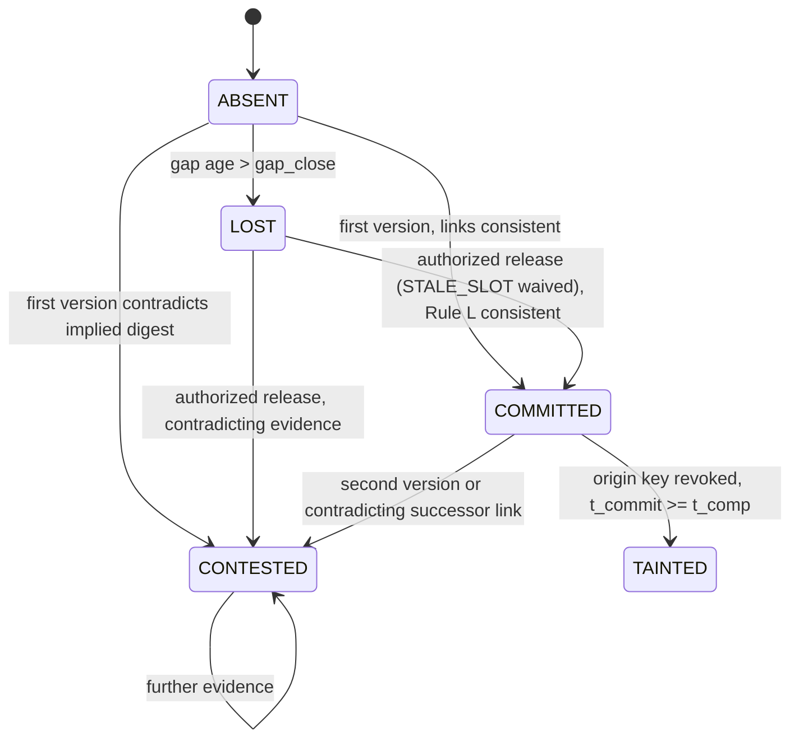

# Deterministic trust/resilience state model

## 1. Design decision: four orthogonal machines, not one flat machine

The candidate list in the research note mixed producer-side steps, verifier check results, delivery
classifications, durable data states and credential states in one flat machine. Analysis showed these have
different *subjects* and *lifetimes*, so the model is split into four orthogonal machines (one one-shot receipt disposition and three durable machines):

| Machine | Subject | Lifetime | States / outcomes |
|---|---|---|---|
| M1 Receipt disposition | one arrival (receipt) of a message | instantaneous, exactly one outcome | ACCEPT, DUPLICATE, CONFLICT, QUARANTINE, REJECT (+ reason, annotations) |
| M2 Event-identity slot | `e = (did, ep, seq)` | durable | ABSENT → COMMITTED → CONTESTED; ABSENT → CONTESTED; ABSENT → LOST; LOST → COMMITTED/CONTESTED only by authorized release; COMMITTED → COMMITTED+TAINTED |
| M3 Credential | key id | durable, issued by identity plane | ACTIVE → EXPIRED-IN-GRACE → EXPIRED; ACTIVE/EXPIRED → REVOKED(t_rev, t_comp) |
| M4 Derived record | (asset, window) | durable, versioned | v1 NEW → v(k+1) LATE / CONTEST / TAINT correction |

### Disposition of the candidate states

| Candidate | Decision | Reason |
|---|---|---|
| CREATED, IDENTIFIED | removed | producer-side facts; the verifier only sees signed statements |
| ATTESTED | moved to M3 precondition | attestation (e.g., RATS, SPIRE node/workload attestation) conditions credential issuance; it is not per event |
| AUTHORIZED, VERIFIED, RECEIVED | removed as states | intermediate check results inside one atomic admission step |
| ACCEPTED + COMMITTED | merged | acceptance and raw commitment are atomic (ACCEPT disposition ⇒ COMMITTED slot) |
| QUARANTINED, REJECTED, DUPLICATE | M1 dispositions | outcomes of a receipt, not of the event identity |
| CONFLICT | M1 disposition + M2 state CONTESTED | the receipt reveals equivocation; the identity becomes contested permanently |
| REPLAYED | M1 annotation (SUSPECTED_REPLAY) | replay and retry are byte-identical; distinguishable only by context, never authoritative |
| REVOKED | M3 state; TAINTED flag in M2 | revocation is a credential fact; its effect on data is the taint flag |
| SUPERSEDED | M4 only | raw observations are immutable; only derived versions are superseded |
| RECOVERED | M1 annotation | recovery is a delivery context of an ACCEPT, not a state |

## 2. M1: receipt classification for the twelve required distinctions

| # | Situation | Evidence | Disposition | Slot effect |
|---|---|---|---|---|
| 1 | first valid observation | valid sigs, PERMIT, fresh, slot ABSENT, consistent links | ACCEPT IN_ORDER/AHEAD | ABSENT→COMMITTED |
| 2 | legitimate retry | same `cd` already in slot, same relay, within `retry_window` | DUPLICATE RETRY | none |
| 3 | exact duplicate (transport redelivery) | same `cd` | DUPLICATE RETRY or SUSPECTED_REPLAY | none |
| 4 | conflicting duplicate | different `cd` for same `e`, both validly signed | CONFLICT EQUIVOCATION | →CONTESTED |
| 5 | malicious replay (exact) | same `cd`, outside window or other path | DUPLICATE SUSPECTED_REPLAY | none |
| 5' | replay with modified fields | signature/binding fails | REJECT BINDING_MISMATCH / INTEGRITY_* | none |
| 6 | valid late event | slot ABSENT, `seq < hw`, within horizon | ACCEPT LATE | ABSENT→COMMITTED; derived LATE_CORRECTION |
| 7 | out-of-order event | as 6 or AHEAD | ACCEPT LATE/AHEAD | final state independent of delivery order for a fixed admitted evidence set |
| 8 | buffered recovery event | `mode=buffered`, within horizon | ACCEPT …, RECOVERED | ABSENT→COMMITTED |
| 8' | buffered beyond horizon | `t − ts > h_max` | QUARANTINE STALE_TS; a signed authorized review may re-run admission with only this reason waived | no slot change unless release admission succeeds |
| 9 | unauthorized event | PDP DENY (path, asset, schema, origin) | REJECT UNAUTHORIZED:* | none |
| 10 | integrity-invalid event | signature or binding fails | REJECT INTEGRITY_* / BINDING_MISMATCH | none |
| 11 | revoked producer | key revoked at `t` | REJECT REVOKED / QUARANTINE REVOKED_BUFFERED (ordinary admission); an authorized release may waive REVOKED_BUFFERED only if the release-evidence condition holds (`discretionary`: `ts < t_comp`, a policy condition, not evidence; `witness`: token for the exact digest before `t_low`; `none`: never) | none (past commits: TAINT, M2) |
| 12 | provenance-invalid event | `prev` contradicts known neighbour | CONFLICT LINK_MISMATCH | →CONTESTED |

## 3. M2 transition rules (Current + Evidence + Policy + Condition → Next)

| Current | Evidence | Policy/condition | Next | Cause recorded |
|---|---|---|---|---|
| ABSENT | first version `cd`, no implied digest or implied = `cd` | admission passed | COMMITTED | ACCEPT |
| ABSENT | first version `cd`, implied digest ≠ `cd` (successor known) | admission passed | CONTESTED | LINK_MISMATCH |
| ABSENT | implied digest only | — | ABSENT (expected digest known) | — |
| COMMITTED | second version `cd' ≠ cd` | admission passed | CONTESTED | EQUIVOCATION |
| COMMITTED | successor with `prev ≠ cd` | admission passed for successor | CONTESTED | LINK_MISMATCH |
| COMMITTED | revocation of origin key with `t_comp ≤ t_commit` (a revised record can only move `t_comp` earlier; the selector re-runs, decision D05) | revocation observed; for a slot committed by a REVOKED_BUFFERED release: its release condition fails under the current record | COMMITTED+TAINTED | REVOCATION |
| ABSENT (in open gap) | gap age > `gap_close_ms` | tick | LOST | GAP_CLOSED |
| CONTESTED | any | — | CONTESTED (absorbing) | evidence appended |
| LOST | arriving version without an authorized waiver | ordinary admission | LOST (receipt QUARANTINE STALE_SLOT) | STALE_SLOT |
| LOST | authorized release re-evaluates the version | only STALE_SLOT waived; other checks apply | COMMITTED or CONTESTED under Rule L, or no authoritative admission on failure (RELEASE_FAILED) | signed REVIEW evidence |
| ABSENT | authorized release re-evaluates a quarantined version (STALE_TS, STALE_EPOCH, REVOKED_BUFFERED, …) | only the case's reason waived; REVOKED_BUFFERED also needs the release-evidence condition | COMMITTED or CONTESTED under Rule L; a conflict records the version as evidence and nothing becomes authoritative | signed REVIEW evidence |

Determinism: slot state = f(set of admitted versions, set of implied digests, lost flag). Admission of a
version depends on the receipt, the policy version in force, credential status at `t`, and slot/stream state;
ties are impossible because receipts are processed sequentially in verifier order.

## 4. Invariants (testable)

| Id | Statement | Oracle / test | Experiments |
|---|---|---|---|
| I1 Integrity | Any modification of a protected field of `obs` or `rel` without the corresponding key causes REJECT and no state change. | `tests/test_evidence_and_envelope.py` (all 13 fields); nonlegit_auth = 0 | E2, E3, E6 |
| I2 Authorization | Every COMMITTED slot has an ACCEPT evidence record with a PERMIT under the policy version in force. | audit A-REG; nonlegit via unauthorized path = 0 | E4, E15 |
| I3 Idempotency | For every `e`, at most one authoritative observation; repeated delivery of admitted content changes nothing. | dup_auth = 0 | E7, E11/E12 |
| I4 Non-overwrite | ≥ 2 distinct validly signed contents for `e` ⇒ CONTESTED; no version is authoritative; all are preserved. | nonlegit_auth from equivocation/gap-fill = 0 (gap-fill: if the genuine successor arrives; a lost successor leaves the forgery committed, observed 0.15/run in the mixed workload) | E5, E8, ABL |
| I5 Provenance | Every latest derived version references only authoritative raw objects, its inputs root and aggregates recompute, and it is complete. | audit A-LIN | all |
| I6 Immutability | Committed raw bytes and checkpointed evidence cannot change undetected. | audit A-RAW, A-EVID under T1–T5 | E16 |
| I7 Credential enforcement and taint | Ordinary admission after an observed revocation is refused or quarantined; authorized release exceptions (REVOKED_BUFFERED waiver under the release-evidence policy) and origin-key taint are specified separately; the selector uses verifier commit time, not proof of creation time. | E14 ordinary-admission/taint counts; release-then-taint regressions (`tests/test_v3_review_b5.py`, `tests/test_v4_release_evidence.py`); A5 lifecycle matrix | E14, V3 review tests, A5 |
| I8 Recovery | Within horizon and buffer capacity, every legitimately buffered observation is committed exactly once. (A SUSPECTED_REPLAY label can still occur for retransmissions arriving after the retry window; it is non-authoritative and is reported as a metric.) | legit_missing = 0, dup_auth = 0 | E11/E12 |
| I9 Convergence | Final slot states and derived state are identical for every delivery order of the same admitted evidence set (not for every arrival schedule: admission itself can depend on timing). | `tests/test_registry_rules.py` (permutations); windows exact under reordering | E9, E10 |
| I10 Determinism | Replaying the receipt log reproduces every disposition and the registry. | audit A-DET | all PBTI runs |

## 5. Diagrams

`paper/figures/fig_chain_state.pdf` (TikZ source `paper/figures/fig_chain_state.tex`; Figure 2b of the manuscript). Mermaid source for M2:

## 6. V4 additions (revision V4)

* **Locality (Proposition 1, `formal/LOCALITY_PROOF.md`).** k admitted statements change the evidence, Rule L class
  and PBTI authority of at most the 2k identities in A(S) (their own identities and predecessors), outside lifecycle
  transitions. Bounded cross-checks: `formal/v4_locality_lifecycle_check.py`.
* **Review rules (`src/pbti/review.py`).** `oneshot` (V3): an uncorroborated reviewed case is REJECTED. `defer` (V4):
  RELEASE if corroborated, REJECT only if contradicted, otherwise the case stays QUARANTINED. Review triggers:
  `periodic` (minimum case age R, cadence C) or `event` (immediately after every admission that can change a pending
  case's evidence; cascading). R = 0 with a periodic scheduler is not event-driven review.
* **Selective holds (PBTI-SH, `src/pbti/selective.py`, separate code path).** Feed suspect from its first CONTESTED
  slot (for the epoch); a COMMITTED, successor-uncorroborated observation of a suspect feed is PROVISIONAL (not
  authoritative, not derived), retroactively at the moment of suspicion; released only by an admitted successor link
  naming exactly its digest (`SH_CORROBORATED`) or, in the timeout variant, after `timeout_ms` (`SH_TIMEOUT`);
  contested or tainted provisional slots are never released. The Rule L slot state itself is unchanged.
* **Release-evidence policy (`src/pbti/verifier.py`, `src/pbti/timewitness.py`).** `none` | `discretionary` (V3) |
  `witness`; a slot committed by a REVOKED_BUFFERED release stays exempt from taint only while its condition holds.
* **Revised revocation records (D05, `src/pbti/identity.py`).** A key stays revoked from its first revocation;
  a revision merges conservatively (earliest revocation time, earliest known compromise time) and re-runs the taint
  selector.
